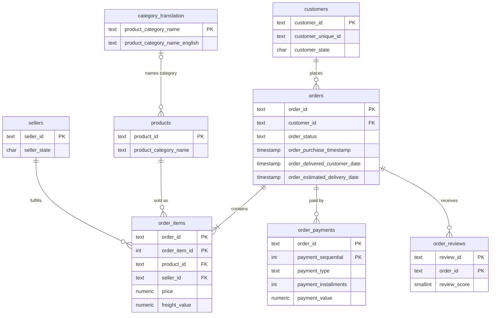

# Olist E-commerce Analytics in SQL

Analysis of about 100,000 real orders from Olist, a Brazilian online marketplace (2016–2018), using PostgreSQL. I designed a relational model for the 9 source tables, loaded them with a repeatable Python pipeline, and wrote SQL to answer 15 business questions on revenue, retention, delivery, sellers and payments.

**Skills shown:** relational data modeling, PostgreSQL, CTEs, window functions (`LAG`, `RANK`, `NTILE`, running totals), cohort analysis, RFM segmentation, data quality handling, Python + Docker.

## Key findings

> Fill this in after running the analysis on the real data (see `results/SUMMARY.md`). Write 4–6 bullets, each as a number plus what a business should do about it. Example format:
> - **Late deliveries cut review scores from X to Y.** Fixing the slowest states would protect ratings for Z% of orders.

- 
- 
- 
- 

## Dashboard

Interactive sales performance dashboard in Tableau Public: KPIs with like-for-like year-over-year, monthly trend, state map, region → state drill-down, top categories, and how late deliveries hit review scores. Click a state to filter everything.

> Add after publishing: **[View on Tableau Public](LINK)**
>
> 

Built from `sql/04_dashboard_views.sql`, exported by `scripts/export_for_tableau.py`. Step-by-step build guide: [`docs/TABLEAU_DASHBOARD.md`](docs/TABLEAU_DASHBOARD.md).

## Business questions

| # | Question | Main SQL techniques |
|---|---|---|
| 1 | How are revenue and orders trending month over month? | `DATE_TRUNC`, `LAG` |
| 2 | What share of customers buy again? | `FILTER`, choosing the right customer key |
| 3 | How well does each monthly cohort retain? | Cohort analysis, `MIN() OVER`, `AGE` |
| 4 | Which states get the most late deliveries? | Boolean aggregation, `HAVING` |
| 5 | How much does a late delivery hurt reviews? | `CASE` bucketing |
| 6 | Which categories drive revenue? | `RANK`, share of total, cumulative share |
| 7 | Is revenue concentrated in a few sellers? | `NTILE` deciles, Pareto |
| 8 | Which high-volume sellers deliver the worst experience? | Seller scorecard, multi-table joins |
| 9 | How do customers pay? | Aggregating at the correct grain |
| 10 | Do installment buyers spend more? | `PERCENTILE_CONT` (median) |
| 11 | Where does shipping eat the largest share of the basket? | Ratio of sums |
| 12 | Customer segments by Recency, Frequency, Monetary | RFM scoring with `NTILE` |
| 13 | Where is time lost between purchase and delivery? | Timestamp arithmetic by stage |
| 14 | Is unhappiness caused by the product or the delivery? | Controlling for late orders |
| 15 | When do customers shop? | `EXTRACT`, pivot with `FILTER` |

Each query lives in `sql/analysis/`. A plain-English explanation of every query is in [`docs/WALKTHROUGH.md`](docs/WALKTHROUGH.md).

## Data model



`geolocation` is loaded as a reference table without keys, because the source has many rows per zip code.

## Data quality decisions

- **`customer_id` is not a customer.** Olist creates a new `customer_id` for every order. Repeat-purchase and retention analysis uses `customer_unique_id` instead; using the wrong key would show a 0% repeat rate.
- **`review_id` is not unique.** The same review ID appears on more than one order, so the reviews key is `(review_id, order_id)`. Orders with several reviews keep the most recent one in `v_order_review`.
- **Duplicates are counted, not hidden.** The loader stages each CSV, inserts with `ON CONFLICT DO NOTHING`, and prints how many duplicate keys it skipped.
- **Incomplete months are excluded** from trend queries (data before Jan 2017 and after Aug 2018 is sparse).
- **Impossible timestamps are filtered** in the fulfillment analysis (for example, delivered to carrier before approval).
- **Source typos fixed** (`product_name_lenght` → `product_name_length`).
- **Business logic lives in views** (`sql/02_views.sql`), so "revenue", "late" and "delivered" mean the same thing in every query.

## How to run it

Requirements: Docker Desktop and Python 3.9+.

```bash
# 1. Get the data: download the Kaggle dataset (link in data/README.md) and unzip the 9 CSVs into data/

# 2. Start PostgreSQL
docker compose up -d

# 3. Install Python packages
pip install -r requirements.txt

# 4. Build the schema and load the data (about a minute)
python scripts/load_data.py

# 5. Run all 15 queries -> results/*.csv and results/SUMMARY.md
python scripts/run_analysis.py

# 6. Export CSVs for the Tableau dashboard
python scripts/export_for_tableau.py
```

To explore by hand, connect any SQL client (DBeaver, pgAdmin, VS Code) to `localhost:5432`, database `olist`, user `olist`, password `olist`, then `SET search_path TO olist;`.

## Project structure

```
├── data/                  CSVs go here (not committed)
├── docs/WALKTHROUGH.md    How each query works, in plain English
├── results/               Query outputs + SUMMARY.md (generated)
├── scripts/
│   ├── load_data.py       Builds schema, stages and loads the CSVs
│   └── run_analysis.py    Runs every query and exports results
├── sql/
│   ├── 01_schema.sql      Tables, keys, indexes
│   ├── 02_views.sql       Shared business logic
│   ├── 03_data_quality_checks.sql   Run automatically after loading
│   ├── 04_dashboard_views.sql       Views exported for Tableau
│   └── analysis/          q01–q15, one file per question
└── docker-compose.yml     PostgreSQL 16
```

## Data source

[Brazilian E-Commerce Public Dataset by Olist](https://www.kaggle.com/datasets/olistbr/brazilian-ecommerce) on Kaggle (CC BY-NC-SA 4.0).
